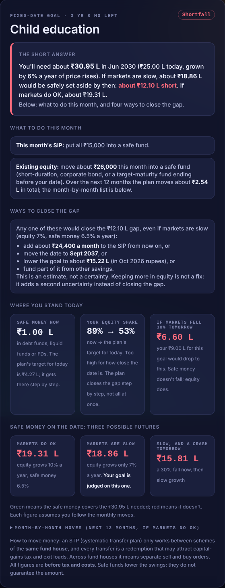
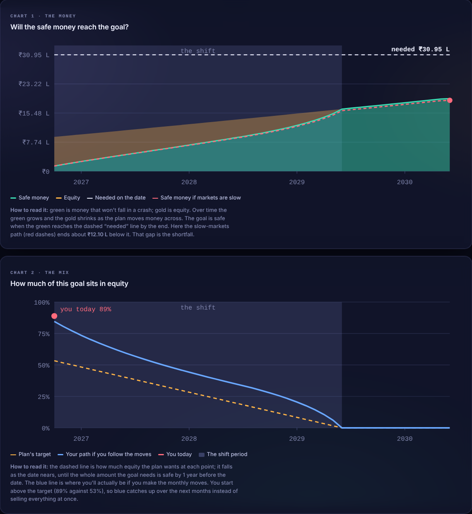
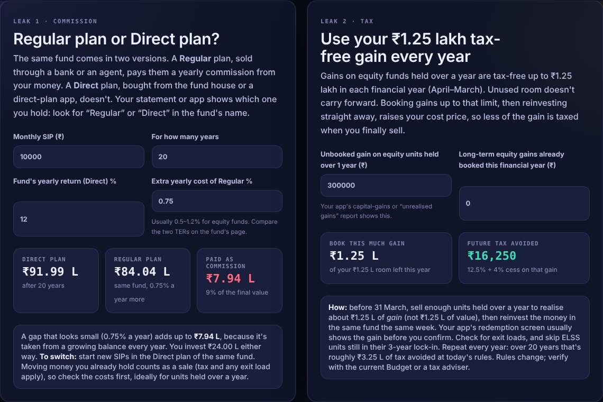

<p align="center"></p>

<h1 align="center">SIP Compass</h1>

<p align="center">by <a href="https://github.com/Perfectbyte"><b>Perfectbyte</b></a></p>

<p align="center"><b>A free, private SIP planner and mutual fund checker for Indian investors.<br>It runs from a folder on your own computer.</b></p>

<p align="center">


</p>

<p align="center"></p>

No account, no login, no sign-up. Everything you type (your goals, holdings and plans) stays in your own browser on your own computer. The page fetches only public data: fund NAVs and the page fonts.

> **SIP Compass is an educational tool, not investment advice.** The author is not a SEBI-registered investment adviser or research analyst. Mutual fund investments are subject to market risks; read all scheme-related documents carefully.

## Why it exists

Most SIP mistakes are quiet. Nothing on your statement says *"you picked the wrong category for your timeline"*, *"this Regular plan costs you lakhs in commission"*, or *"this goal money is still in equity a year before you need it"*. Yet those decisions often matter more than which fund you pick.

SIP Compass puts those decisions in front of you in plain language, shows the maths behind every number, and lets you plan for your own goals without handing your financial life to an app or a login screen. Whether you're starting your first SIP or reviewing ten years of them, it's built to help you invest calmly, on purpose.

## What it does

| Tab | What it helps with |
| --- | --- |
| **My Plan** | Turns your budget, time horizon and risk comfort into a category mix and a projected range. |
| **Goal Guard** | Protects money for a dated goal (fees, a house, retirement). It tells you whether you're on track, what to move each month, and what would close a shortfall. Two charts show the plan. |
| **Top Funds** | Ranks Direct–Growth funds within each official AMFI category on steady returns, worst stretches and crash behaviour. |
| **Debt Desk** | Picks safe-money categories by when you need the money, with credit-accident checks. |
| **Time Machine** | Replays what a SIP in a fund would actually have done. |
| **Check My SIP** | Reviews a fund you already hold: keep, watch, investigate or replace, with reasons. Checks your real XIRR, and finds two money leaks: Regular-plan commission and the unused ₹1.25 lakh tax-free gain. |
| **Ask AI** | Optional. Explains your plan using a model running on your own computer through [Ollama](https://ollama.com). Nothing is sent to a cloud AI. |
| **The Rules** | The ten rules behind the tool, how the score works, tax basics, and a built-in self-test you can run. |

## A look inside

| Goal Guard: the short answer first | Goal Guard: two charts that explain the plan |
| --- | --- |
|  |  |

<p align="center"></p>

## Quick start

1. **Download** the latest version from [Releases](https://github.com/perfectbyte/SIP-Compass/releases), or use the green **Code** button → **Download ZIP**, and extract it somewhere normal, such as `Documents\SIP-Compass`.
2. **Double-click `Open SIP Compass.cmd`** (macOS/Linux: `sh open-sip-compass.sh`). It opens the app in your browser at `http://localhost:8765`, an address only your own computer can reach. A small window stays minimised while you use it; close it to stop.
   - Or just double-click `SIP-Compass.html`. Everything works except **Ask AI**, because Ollama won't answer a page opened directly as a file.
   - Pick one way and stick to it: each way keeps its own saved data. To move your data between them, use **About → Save my data to a file / Load from a file**.

That's all you need. On first open the page downloads NAV histories for the funds it scores (about a minute) and keeps them in your browser.

### Optional: build the local data bundle

`data.js` ships with a starter snapshot of expense ratios (TER) and fund sizes (AUM). To download full NAV history and refresh those figures into this folder, run the updater once. It needs **Python 3.10+** (python.org or Anaconda) and no extra packages.

- **Windows:** double-click **`Update SIP Compass.cmd`**.
- **macOS / Linux:** `sh update.sh`

The first run takes a few minutes. Afterwards the page reads fund history from this folder, and the status pill says **Local**. To refresh automatically every night on Windows, right-click `updater\Enable-Daily-Update.ps1` → **Run with PowerShell**.

## Where your data lives

| What | Where | Leaves your computer? |
| --- | --- | --- |
| Goals, holdings, plan, theme | Your browser's local storage for this page | **Never** |
| Fund NAVs | Downloaded from [mfapi.in](https://www.mfapi.in) (AMFI data), or `data.js` after an update | Only the request for public data |
| Expense ratios, fund sizes | [AMFI](https://www.amfiindia.com) public disclosures, via the updater | Only the request for public data |
| Fonts | Google Fonts | Only the font request |
| Ask AI | Your local Ollama on `localhost` | **Never** |

Browser storage is tied to the browser and the file's location. If you move the folder or switch browsers, your saved goals won't follow. Re-enter them, or keep the folder where it is. Clearing site data in your browser erases them.

## Folder layout

```
SIP-Compass/
├── Open SIP Compass.cmd      Windows: open the app (open-sip-compass.sh on macOS/Linux)
├── SIP-Compass.html          the app
├── data.js                   public fund data bundle, rewritten by the updater
├── Update SIP Compass.cmd    Windows: refresh data
├── update.sh                 macOS / Linux: refresh data
├── launcher/                 tiny local web server (localhost only, read-only)
├── updater/                  Python updater (standard library only) and its launchers
├── tests/                    updater unit tests
├── scripts/run-selftest.mjs  runs the app's built-in self-test headlessly
├── docs/                     user guide, how it works, research evidence, images
└── .github/workflows/        CI: runs both test suites on every push
```

## Documentation

- [User guide](docs/USER-GUIDE.md): first run, each tab, everyday use, troubleshooting.
- [How it works](docs/HOW-IT-WORKS.md): data cleaning, scoring, Goal Guard's maths, and the known limits.
- [Changelog](CHANGELOG.md)
- [Contributing](CONTRIBUTING.md)
- [Privacy and security](SECURITY.md)

## Honest limits

- Rankings are **historical peer comparisons**, not forecasts. In our own backtest the top-5 funds beat their category median in 11 of 20 usable comparisons, which is close to a coin flip. Treat the scores as a filter for obviously weak funds, not a way to find tomorrow's winner.
- Plans assume the returns you set, and are **before tax, exit loads and costs**.
- Portfolio holdings and fund-manager changes are not covered: check the factsheet.
- The tax table reflects the rules at the time of writing. Verify current rules before acting.

## How it was built

SIP Compass was created by [Perfectbyte](https://github.com/Perfectbyte). It started as a personal tool. It was built with AI assistants: Claude (Anthropic) wrote and tested most of the app, and ChatGPT/Codex independently audited it and built the data updater. Every change had to pass the app's self-tests (106 checks) and the updater's 28 unit tests.

## License

[MIT](LICENSE) © 2026 Perfectbyte. Free to use, change and share. No warranty.
